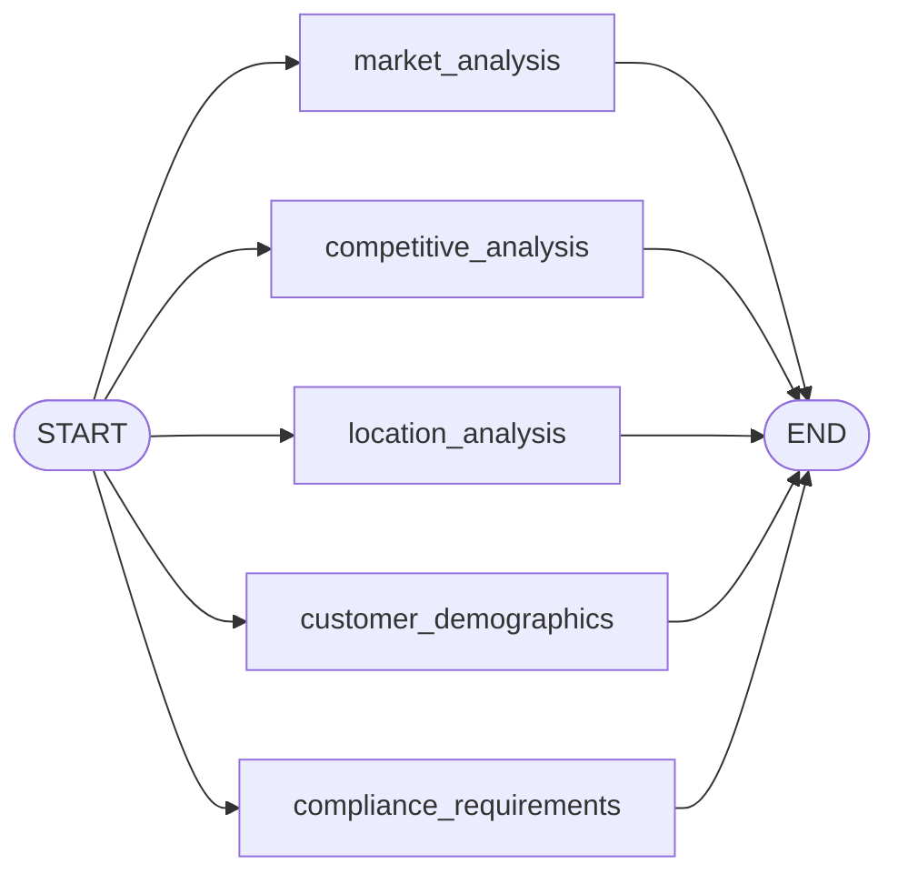
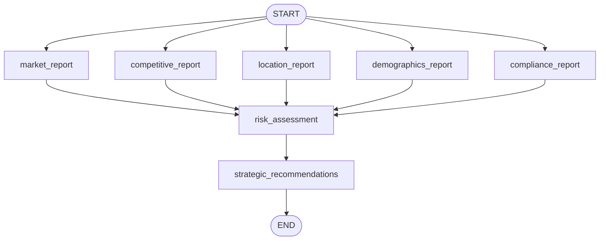
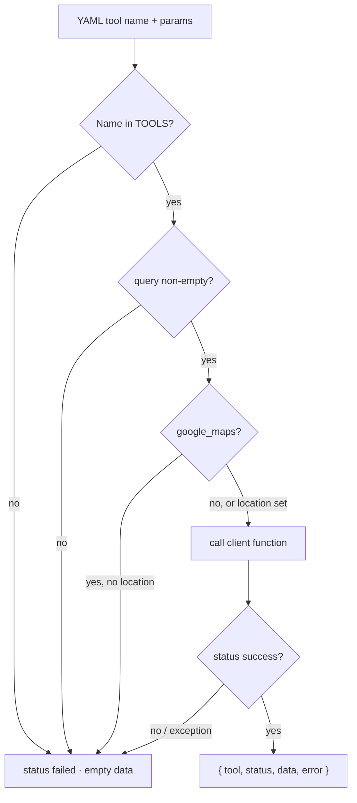
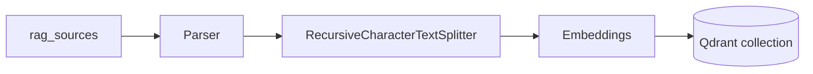
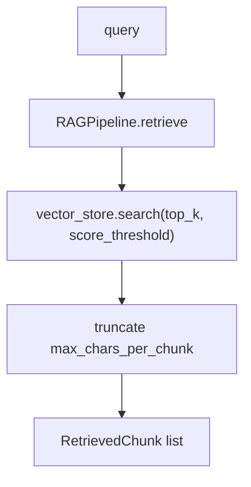

# Architecture

Internal wiring: LangGraph graphs, `run_tool`, and RAG ingest/retrieve.

Product context, setup, and how to run: **[README.md](README.md)**.

---

## Pipeline

**Product entry:** `python -m src.pipeline_runners.pipeline`  
(`src/pipeline_runners/pipeline.py`)

Loads `business_case.default` into `WorkflowState`, then:

1. `ResearchWorkflow.run(state)` — `StateGraph` fan-out  
2. `ReportWorkflow.run(state)` — `StateGraph` DAG  
3. `ReportCompiler.compile(state)` — Python, not a graph  
4. `export_report(...)` → `reports/report_*.md` and `.json`

This command does **not** write research JSON. Stage checkers (same graphs, stop after one stage):

| Module | Role |
|--------|------|
| `research_pipeline_runner.py` | Research only; save evidence JSON (`reports/processed_evidence/research_results_*.json`) |
| `report_pipeline_runner.py` | Report + compile from saved research JSON (newest file). No Maps / Tavily |

Tools are not a separate runner. Research nodes call `run_tool` (tool pipeline below). RAG ingest: `python -m src.rag.ingest_all` (offline). Retrieve is the `rag` tool inside research, not a separate graph.

Shared state: `src/graph_states/workflow_states.py`.  
Research merges `research_results` with `operator.or_` and `errors` with `operator.add`.  
Report merges `section_reports` with `operator.or_`.

---

## Research graph (fan-out)

**Graph:** `src/workflow/research/research_workflow.py`  
**Node:** `src/workflow/research/research_section_runner.py`

`START` → every enabled `research.sections` node → `END`. No edges between sections. No chat LLM.

Each node:

1. Formats YAML query templates from state.
2. Calls `run_tool` (tool pipeline below).
3. Normalizes with `EvidenceProcessor` into `EvidenceItem` dicts.
4. Dedupes, sorts, applies `resource_limits` character caps.
5. Returns `{ research_results: { section_name: result }, errors: [...] }`.

---

## Report graph (DAG)

**Graph:** `src/workflow/report/report_workflow.py`  
**Node:** `src/workflow/report/report_section_runner.py`

Edges from `report.sections.*.dependencies`.

`_build_prompt`: `research_section` set → Insights from `research_results` (`_mix_tools`). `research_section: null` → Insights from other section reports (risk and strategy).

Chat LLM via `model_loader` (`defaults.analysis_llm`). Output: `ReportSectionResult`. Retry: `reporting.retry`.

---

## Compiler

`src/workflow/report/report_compiler.py` and `report_exporter.py`. No LLM. Successful sections only. `##` section titles; LLM headings become `###`. Executive summary from first paragraphs. Conclusion from strategy GO / CONDITIONAL GO / NO GO and numbered actions.

---

## Tool pipeline

**Files:** `src/common/tools/tool_pipeline.py`, `tool_registry.py`

Every research node calls `run_tool(name, params)`. YAML may only name keys in `TOOLS`.

| YAML name | Function |
|-----------|----------|
| `tavily_search` | `tavily_client.tavily_search` |
| `google_maps` | `serpapi_client.google_maps` (`query` + `location`) |
| `google_trends` | `serpapi_client.google_trends` |
| `rag` | `rag_client.rag_search` → RAG retrieve below |

Failed calls go on section `errors`. Remaining successes still pass through `EvidenceProcessor`.

---

## RAG pipeline

**Ingest** (offline) and **retrieve** (the `rag` tool). No chat LLM in either.

### Ingest

**Files:** `src/rag/ingest_all.py`, `src/rag/ingestion/ingestion_pipeline.py`  
**Sources:** `rag_sources` in `configs.yaml` (`local_pdfs`, `websites`, `online_pdfs`).

Collection: `rag_vectorstores.qdrant.collection_name`.

### Retrieve

**Files:** `rag_client.py` → `src/rag/rag_pipeline.py` → `src/rag/retriever/retriever.py`

Limits: `rag_retrieval` in `configs.yaml`. Truncation is in the retriever. `RAGPipeline` is retrieve-only.

---

## State contracts

| Field | Reducer | Role |
|-------|---------|------|
| Business and location | — | Input |
| `research_results` | `operator.or_` | Evidence per research section |
| `section_reports` | `operator.or_` | Markdown per report section |
| `errors` | `operator.add` | Tool failures |

Pydantic: `src/common/schemas.py`. Nodes `model_validate` then `model_dump()` into the TypedDict.
